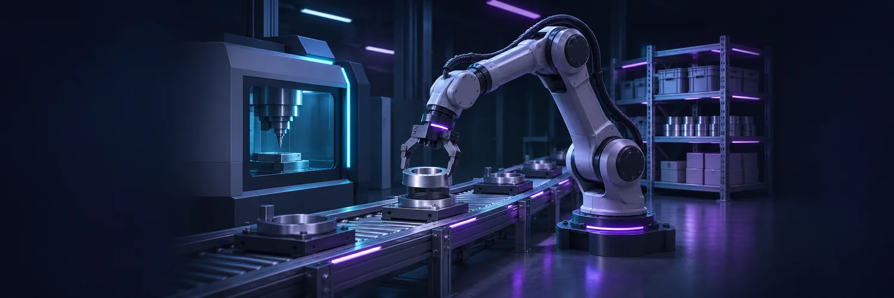
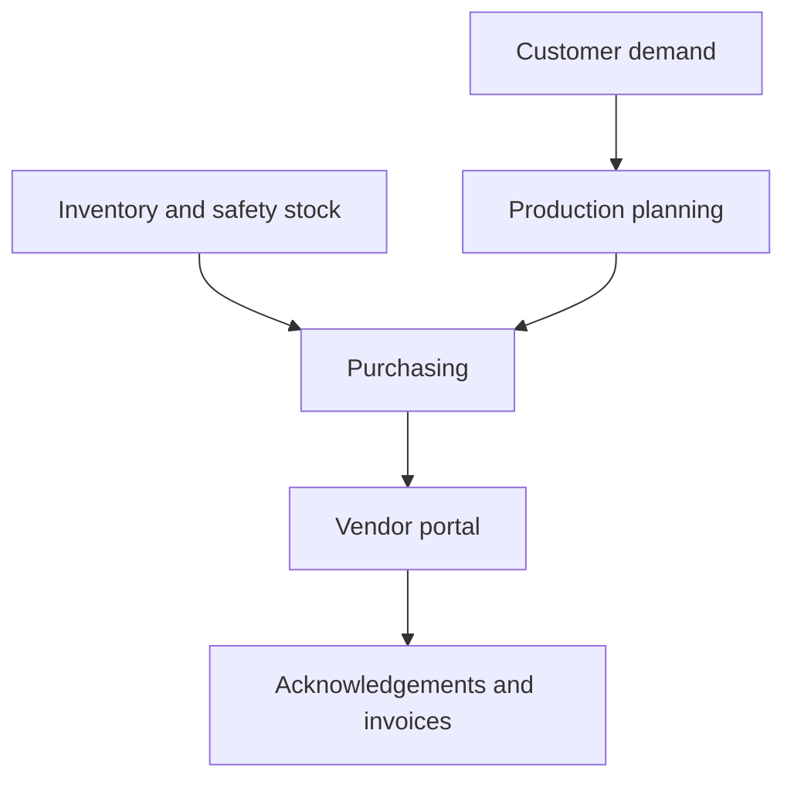

  

<h1 align="center">Hi, I’m Anbarasan</h1>

<strong>Senior .NET Full Stack Developer</strong> 
Manufacturing ERP · Production Planning · Supply Chain Systems

  
  
  
  
  

  <a href="#selected-work">Selected work</a> ·
  <a href="#technology">Technology</a> ·
  <a href="#experience">Experience</a> ·
  <a href="https://github.com/Anbarasan1992?tab=repositories">Public repositories</a>

I have **10+ years of experience** building business applications with C#, ASP.NET Core, React, and SQL Server. I build APIs and interfaces for production planning, inventory, purchasing, and supplier coordination, including integration with SAP Business One.

## Selected work

| Project | Workflows |
| --- | --- |
| **Manufacturing ERP** | Production planning, material requirements, inventory, purchasing, and SAP Business One master-data synchronization |
| **Kanban and supplier planning** | Customer demand, safety stock, supplier allocation, and dispatch coordination |
| **Vendor portal** | Purchase orders, supplier acknowledgements, and invoices |
| **Engineering estimation** | Bill-of-materials costing, quotations, revisions, and approvals |

### How the workflows connect

Customer demand informs production planning. Planning and inventory help determine purchasing needs, and suppliers acknowledge purchase orders and submit invoices through the vendor portal.

## Technology

| Area | Tools |
| --- | --- |
| Backend | C#, ASP.NET Core, ASP.NET MVC, REST APIs, Entity Framework, Dapper |
| Frontend | React, JavaScript, HTML, CSS, Bootstrap |
| Data | SQL Server, T-SQL, SAP HANA |
| Integration and delivery | SAP Business One Service Layer, JWT, Git, IIS |

## Experience

| Period | Role | Company |
| --- | --- | --- |
| Nov 2023 – Present | Senior .NET Full Stack Developer | Covalsys Soft Private Limited |
| 2019 – Nov 2023 | .NET Full Stack Developer | Gain Insights Solutions Private Limited |
| Oct 2015 – 2019 | .NET Developer | Abile Business Solutions Private Limited |
