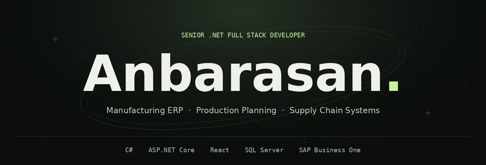
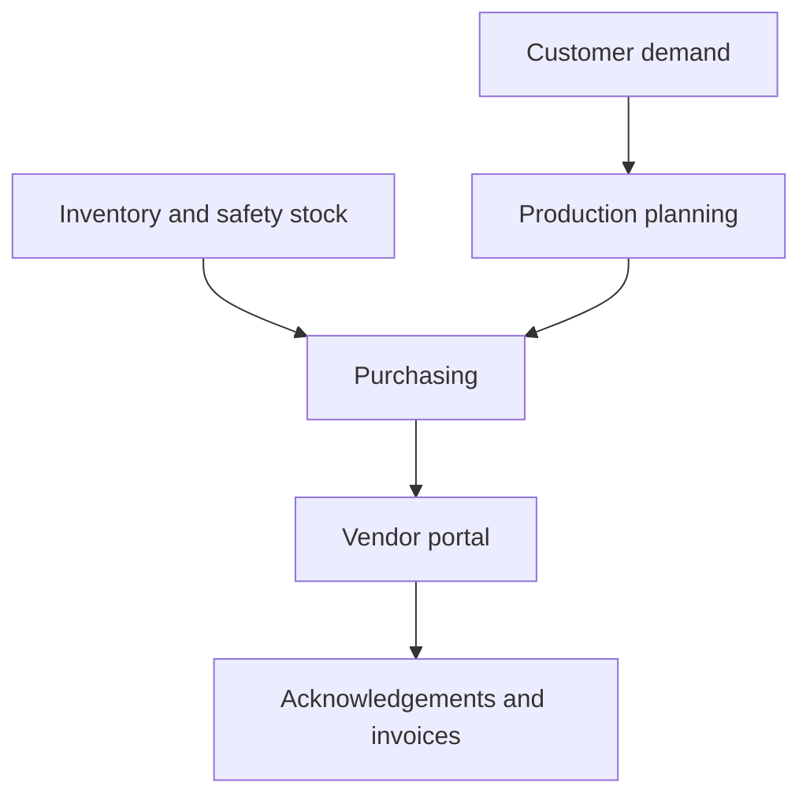

  

  <a href="./docs"><strong>Portfolio source</strong></a> ·
  <a href="#selected-work">Selected work</a> ·
  <a href="#technology">Technology</a> ·
  <a href="#experience">Experience</a>

I have **10+ years of experience** building enterprise software for manufacturing and supply chain operations. My work spans ASP.NET Core APIs, React interfaces, SQL Server data models, and SAP Business One integrations.

## Selected work

| Project | Workflows |
| --- | --- |
| **Manufacturing ERP** | Production planning, material requirements, inventory, purchasing, and SAP Business One master-data synchronization |
| **Kanban and supplier planning** | Customer demand, safety stock, supplier allocation, and dispatch coordination |
| **Vendor portal** | Purchase orders, supplier acknowledgements, and invoices |
| **Engineering estimation** | Bill-of-materials costing, quotations, revisions, and approvals |

### Manufacturing and procurement workflow

## Technology

| Area | Tools |
| --- | --- |
| Backend | C#, ASP.NET Core, ASP.NET MVC, REST APIs, Entity Framework, Dapper |
| Frontend | React, JavaScript, HTML, CSS, Bootstrap |
| Data | SQL Server, T-SQL, SAP HANA |
| Integration and delivery | SAP Business One Service Layer, JWT, Git, IIS |

## Experience

| Period | Role | Company |
| --- | --- | --- |
| Nov 2023 – Present | Senior .NET Full Stack Developer | Covalsys Soft Private Limited |
| 2019 – Nov 2023 | .NET Full Stack Developer | Gain Insights Solutions Private Limited |
| Oct 2015 – 2019 | .NET Developer | Abile Business Solutions Private Limited |

[Browse my public repositories](https://github.com/Anbarasan1992?tab=repositories)
